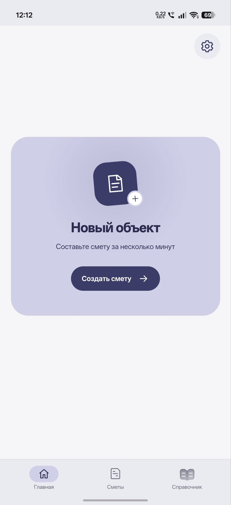
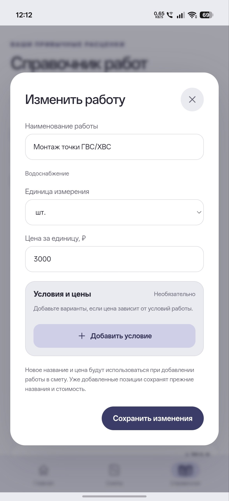
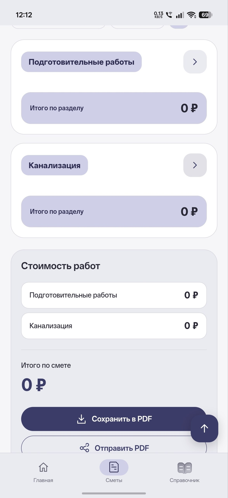
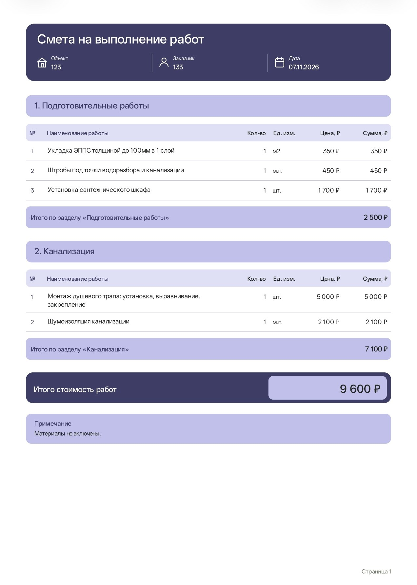

<h1 align="center">Смета</h1>

Сметы на инженерные работы для монтажников и бригад. От замера на объекте до PDF для заказчика.

  <a href="https://github.com/gloryy322/smeta-releases/releases/latest"><strong>Скачать APK для Android</strong></a>
  · <a href="https://github.com/gloryy322/smeta-releases/releases">История версий</a>

## Возможности

- **Сметы по разделам.** Водоснабжение, канализация, отопление, котельные, подготовительные работы и свои разделы.
- **Справочник расценок.** Добавляйте несколько работ сразу, задавайте цены для разных условий монтажа и выбирайте единицы измерения.
- **Расчёт на объекте.** Указывайте объёмы, отмечайте ориентировочные количества и добавляйте комментарии к работам. Приложение пересчитывает суммы по разделам и общий итог.
- **PDF для заказчика.** Сохраняйте смету и отправляйте её из приложения. Дополнительные работы можно оформить отдельной сметой.
- **Работа офлайн.** Сметы и справочник хранятся на устройстве. Для переноса данных есть резервная копия в JSON.

## Скриншоты Android

  
  
  
  

## Пример PDF-сметы

## Установка и обновления

1. Откройте [последний релиз](https://github.com/gloryy322/smeta-releases/releases/latest) на телефоне и скачайте файл `.apk`. Требуется Android 8.0 или новее.
2. Откройте скачанный файл и подтвердите установку в Android.
3. Чтобы узнать о новой версии, откройте **Настройки → Обновления → Проверить обновления**. Устанавливайте новую версию поверх текущей, чтобы сохранить данные приложения.

Если заметили ошибку, [создайте обращение](https://github.com/gloryy322/smeta-releases/issues/new) и укажите версию приложения, модель телефона и шаги, на которых она возникает.
